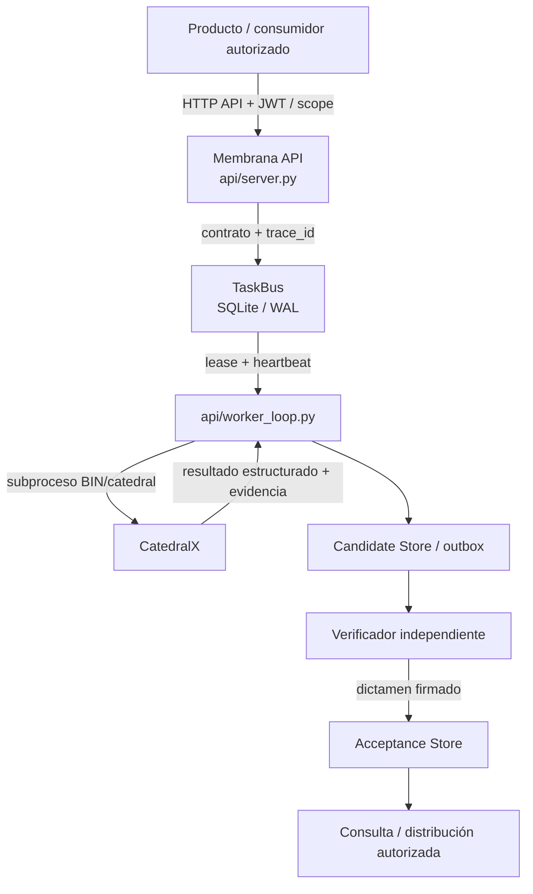

# Membrana API — frontera empresarial de Chalamandra

> Repositorio: `Chalamandra-Magistral-deco/chalamandra-agent-engine`  
> Rama: `work`  
> Base inicial de la rama: `81adb9de89caf3a5bef20d091ac933c679d7aa44`  
> Alcance: documentación de arquitectura basada en el código inspeccionado en `main`; no implica despliegue ni runtime activo.

## 1. Posición en la arquitectura

La Membrana API es la frontera contractual entre el núcleo de razonamiento CatedralX y los productos/consumidores autorizados de Chalamandra. Su implementación vive en el motor Agents; no es un octavo subsistema de CatedralX ni un producto comercial independiente.

- **CatedralX:** autoridad de razonamiento, evaluación, gobernanza y producción de resultados estructurados.
- **Membrana API (Agents):** entrada de solicitudes, autenticación/autorización, validación de contratos, admisión, trazabilidad, encolado, coordinación del worker, publicación y retorno controlado.
- **Agents worker:** ejecuta tareas admitidas y llama a CatedralX mediante su CLI canónica como subproceso.
- **Productos:** consumen capacidades a través de la API de Agents; no acceden directamente a los módulos internos de CatedralX.

## 2. Topología implementada en código

### Archivos de referencia

| Componente | Archivo(s) | Función |
|---|---|---|
| Entrada HTTP | `api/server.py` | Rutas explícitas, autenticación Bearer JWT, scopes, tamaño máximo de cuerpo y trazabilidad de solicitudes. |
| Contratos | `api/task_contracts.py` | Valida tipos de tarea y payloads antes de procesarlos; las evaluaciones financieras/opportunity tienen contratos específicos. |
| Cola | `api/task_bus.py` | Persistencia de tareas, leases y estados mediante SQLite/WAL compartido por API y worker. |
| Worker | `api/worker_loop.py` | Consume tareas, mantiene heartbeat, prepara snapshot y ejecuta `BIN/catedral` mediante subproceso. |
| Candidatos | `api/candidate_store.py` y stores relacionados | Publica y conserva candidatos con controles de integridad; publicación no significa aceptación. |
| Aceptación | `api/acceptance_store.py`, verificador independiente y rutas de aceptación | Conserva el dictamen de aceptación separado del resultado candidato. |
| Trazabilidad | `api/trace_store.py`, `api/trace_parser.py` | Registra `trace_id` y contexto W3C cuando está presente. |

## 3. Contratos y controles observados

- `POST /v1/request`: entrada de solicitudes con scope de escritura de trabajos.
- `POST /internal/v1/orchestration/runs`: entrada interna para orquestación invocada por el servicio CatedralX.
- Las rutas protegidas validan Bearer JWT y scopes; la identidad de servicio se comprueba donde corresponde.
- `api/task_contracts.py` separa objetivos de tarea. Una observación de mercado no concede por sí misma permiso para ejecutar una evaluación económica.
- El worker valida observación, procedencia/attestation, frescura y `trace_id`; genera un snapshot firmado si la configuración de firma está disponible. Sin la firma exigida por CatedralX, el flujo se bloquea fail-closed.
- El worker ejecuta la CLI de CatedralX y verifica `evaluation_hash` a través del verificador canónico.
- Los candidatos se conservan separados de la aceptación independiente.
- La aceptación independiente usa un dictamen firmado Ed25519. No debe confundirse con el JWT HS256 de autenticación/despacho de servicio.
- `trace_id` es trazabilidad; `cycle_id` es un identificador de negocio y no lo sustituye.

## 4. Los tres flujos

1. **Normal:** producto/usuario → Membrana API → TaskBus → worker → CatedralX → resultado candidato y evidencia.
2. **Inverso:** resultado candidato → verificador independiente → aceptación firmada → consulta/entrega o distribución autorizada.
3. **Invertido:** evento/condición autorizada → adaptador de despacho CatedralX → Membrana API → TaskBus/worker → CatedralX → evidencia y verificación. El adaptador es opt-in; la existencia de código no demuestra activación autónoma.

## 5. Estados que no se deben colapsar

`dispatch_accepted` ≠ `execution_completed` ≠ `candidate_published` ≠ `independent_acceptance`.

La aceptación de una solicitud HTTP, la admisión de una tarea, la finalización del worker, la publicación de un candidato y la aceptación independiente son hechos distintos y deben conservar sus propios estados y evidencias.

## 6. Invariantes de la Membrana

1. No permitir que un producto invoque directamente los módulos internos de CatedralX.
2. Autenticar y autorizar cada operación según identidad, sujeto y scope.
3. Validar el contrato de entrada antes de admitir la tarea y validar la salida antes de publicarla.
4. Propagar la traza sin confiar ciegamente en identificadores de contexto aportados por el cliente.
5. Mantener límites de tamaño, concurrencia, tiempo y reintentos.
6. No transformar una intención, un despacho o un candidato en ejecución/aceptación por inferencia.
7. Fallar cerrado cuando falte firma, procedencia, contrato o verificación requerida.
8. Mantener separados el control de acceso de la API y las invariantes de dominio de CatedralX.

## 7. Criterio externo de seguridad API

NIST SP 800-228 recomienda autorización granular por identidad de usuario/servicio, validación de solicitudes y respuestas contra esquema, y secuenciar autenticación → autorización → validación de negocio. Se utiliza como criterio de revisión, no como evidencia de controles desplegados:

- https://csrc.nist.gov/pubs/sp/800/228/upd1/final
- https://nvlpubs.nist.gov/nistpubs/SpecialPublications/NIST.SP.800-228-upd1.pdf

## 8. Estado de evidencia

La documentación se basa en lectura estática de `api/server.py`, `api/task_contracts.py`, `api/worker_loop.py`, `api/candidate_store.py` y los contratos/artefactos de aceptación relacionados, más la auditoría de integración registrada en CHA-12.

**Clasificación:** implementación identificada en código; pruebas aisladas/sintéticas identificadas en la auditoría; runtime entre CatedralX y Agents no verificado en esta actualización. No se ejecutaron servicios, no se usaron credenciales y no se hizo deploy.
